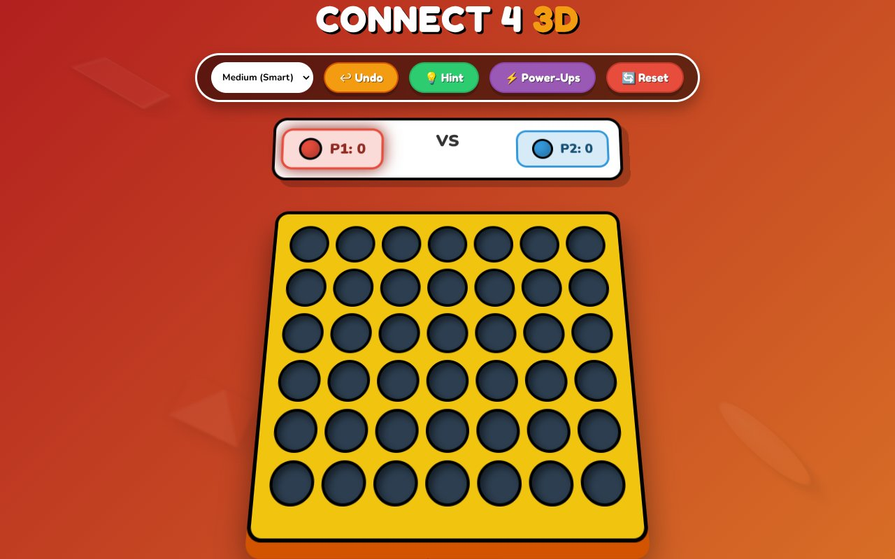
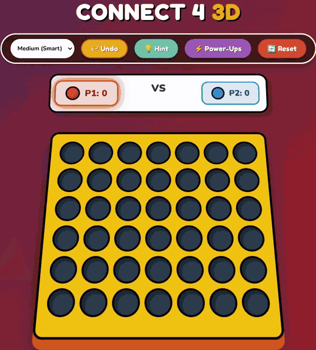

# Connect 4 3D

Connect 4 in the browser with chunky 3D clip-art pieces. Play a friend on the same screen or the computer on Easy, Medium (Smart) or Hard, with undo, hints and power-ups.

**Live:** https://connect-4-game-theta.vercel.app

## Built with

A single `index.html` with plain HTML, CSS and JavaScript. No build step.

## Run it locally

Open `index.html` in a browser.
